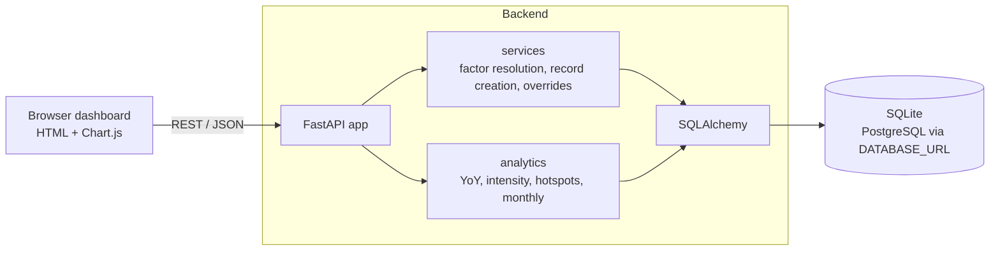
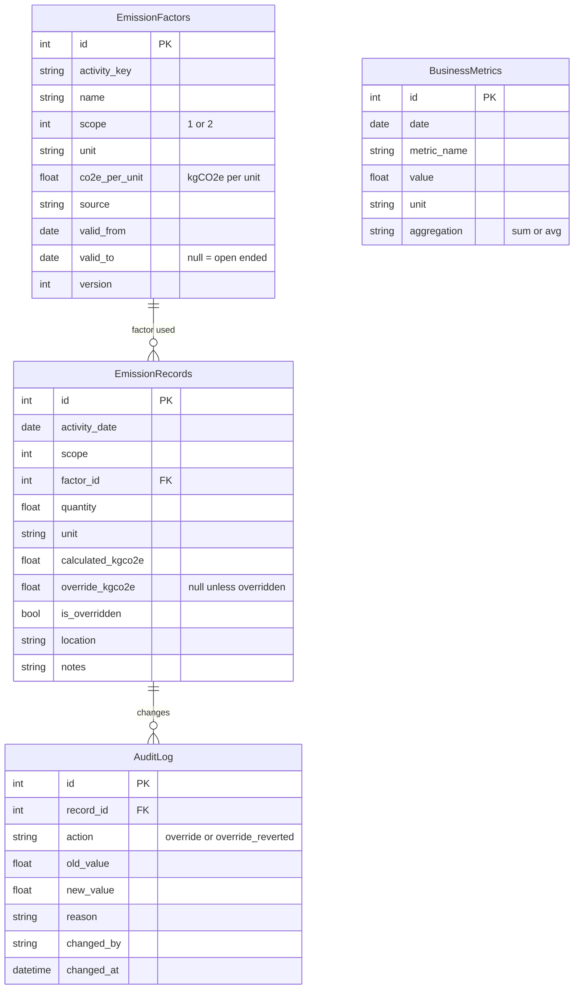

# Carbon Emissions Reporting Platform

A prototype for tracking, calculating and visualising greenhouse gas emissions under the GHG Protocol. It records Scope 1 (direct) and Scope 2 (purchased energy) activity data, converts it to kgCO₂e with versioned emission factors, and reports year-over-year change, emission intensity and source hotspots.

## Architecture



Calculation: `activity quantity × emission factor in force on the activity date = kgCO₂e`.

| Layer | Choice | Why |
|---|---|---|
| API | FastAPI, Pydantic v2 | typed request validation, generated OpenAPI docs at `/docs` |
| Data | SQLAlchemy 2, SQLite by default | zero setup for the prototype; set `DATABASE_URL` to use PostgreSQL |
| Frontend | static HTML, vanilla JS, Chart.js (bundled) | no build step, works offline |
| Packaging | Docker | one command to build and run |

## Database schema



Design decisions:

- **Versioned factors.** Each activity has one row per version with `valid_from` and an optional `valid_to`. A unique key on `(activity_key, valid_from)` and an overlap check in the API keep the windows non-overlapping. Adding a new version starting after an open-ended one closes the older version the day before.
- **Historical accuracy.** A record stores `factor_id`, the factor chosen by the activity date at creation (`valid_from <= date AND (valid_to IS NULL OR valid_to >= date)`), plus the calculated result. Later factor changes never alter past records.
- **Overrides.** The calculated value is never overwritten. An override is stored beside it, and every override or revert writes an `AuditLog` row with old value, new value, reason and author. Reports use `COALESCE(override, calculated)`.
- **Business metrics** carry an `aggregation` (`sum` for flows such as tonnes produced, `avg` for stocks such as headcount) so intensity is computed correctly for both.
- **Units.** All factors are stored as kgCO₂e per activity unit; the dashboard shows tCO₂e.

## Run it

### Docker

```bash
docker build -t carbon-platform .
docker run --rm -p 8000:8000 carbon-platform
```

Open http://localhost:8000. API docs are at http://localhost:8000/docs. To keep data between runs, mount a volume: `docker run --rm -p 8000:8000 -v carbon-data:/app/data carbon-platform`.

On first start an empty database is filled with sample emission factors (including expired versions for 2022 to 2025), monthly activity records for 2023 to the current month, and monthly business metrics. Set `SEED_DEMO_DATA=0` to start empty.

### Locally

```bash
python -m venv .venv
.venv\Scripts\activate        # Windows cmd; use: source .venv/bin/activate on Linux or macOS
pip install -r requirements-dev.txt
uvicorn app.main:app --reload
```

### Tests

```bash
pytest -q
```

## API

| Method and path | Purpose |
|---|---|
| `POST /api/records/scope1` | create a Scope 1 record (`activity_key`, `quantity`, `activity_date`, optional `location`, `notes`) |
| `POST /api/records/scope2` | create a Scope 2 record |
| `GET /api/records` | list records, filter by `scope`, `start`, `end` |
| `PATCH /api/records/{id}/override` | manual override with `override_kgco2e`, `reason`, `changed_by` |
| `POST /api/records/{id}/override/revert` | remove an override (audited) |
| `GET /api/records/{id}/audit`, `GET /api/audit-log` | audit trail |
| `GET /api/factors`, `POST /api/factors` | list or add a factor version |
| `GET /api/factors/resolve?activity_key=&on=` | show which factor applies on a date |
| `POST /api/metrics`, `GET /api/metrics` | business metrics (upsert by date and name) |
| `GET /api/analytics/yoy?year=` | emissions by scope for the year and the previous year |
| `GET /api/analytics/intensity?start=&end=&metric_name=` | kgCO₂e per unit of the chosen business metric |
| `GET /api/analytics/hotspots?start=&end=` | emissions by source with percentage share |
| `GET /api/analytics/monthly?year=` | monthly totals by scope for the line chart |

Example:

```bash
curl -X POST localhost:8000/api/records/scope1 -H "Content-Type: application/json" \
  -d '{"activity_key":"diesel","quantity":500,"activity_date":"2024-03-15"}'

curl "localhost:8000/api/analytics/yoy?year=2025"
```

Validation returns HTTP 422 for an unknown activity, a scope that does not match the activity, a unit that does not match the factor, a non-positive quantity, a future date, or a date with no valid factor.

When the current year is incomplete, `yoy` compares the same months of the previous year by default (`like_for_like=true`), so a partial year is not set against a full one. Pass `like_for_like=false` for full-year totals.

## Dashboard

- Stacked bar chart: year-over-year emissions with Scope 1 and Scope 2 stacks.
- Donut chart: share of emissions by source (hotspots).
- KPI card: emission intensity for the selected metric (tonnes of steel or employees).
- Line chart: monthly total emissions for the selected year.
- Forms: record Scope 1 or Scope 2 activity data, and add or update a business metric.
- Records table: open a record to override its emissions, revert the override, and read its audit trail.

## Sample data

The factor values are sample data for demonstration, not official figures. Replace them with the published factors for your reporting year (for example the CEA CO₂ Baseline Database for grid electricity) before using the platform for real reporting. The captive solar and grid blend factor comes from the supplied `GHG_Sheet_.xlsx`.

Scope 3 is not implemented, as the brief asks for a focus on Scopes 1 and 2.

## Repository layout

```
app/            FastAPI application
  models.py     tables
  schemas.py    request and response models
  services.py   factor resolution, records, overrides, factor versioning
  analytics.py  YoY, intensity, hotspots, monthly queries
  seed.py       sample data
  static/       dashboard
tests/          API and calculation tests
Dockerfile
```

## Requirements coverage

| Brief requirement | Where it is met |
|---|---|
| Scope 1, 2 and 3 distinguished, Scope 1 and 2 implemented | `scope` on factors and records, separate create endpoints, Scope 3 left out as the brief directs |
| Activity data × emission factor = kgCO₂e | `services.create_record` |
| `EmissionFactors` versioned, with units, CO₂e value, source, validity dates | `models.EmissionFactor` |
| `EmissionRecords` linking factor, input and result | `models.EmissionRecord` |
| `AuditLog` for manual overrides | `models.AuditLog`, written by `services.apply_override` and `revert_override` |
| `BusinessMetrics` over time | `models.BusinessMetric` |
| Factor valid at the time of the activity | `services.resolve_factor`, tests in `tests/test_api.py` |
| Emission intensity per tonne of product or per employee | `GET /api/analytics/intensity` |
| Architecture diagram, stack and schema in the README | sections above |
| Sample data including expired factors, and business metrics | `app/seed.py` |
| Scope 1 and 2 record APIs and override with audit trail | `app/main.py` |
| YoY, intensity and hotspot APIs | `app/analytics.py` |
| Form for Scope 1 data and business metrics | dashboard forms |
| Dashboard with at least three of the four charts | all four are implemented |
| Docker and step-by-step run instructions | `Dockerfile`, this file |
